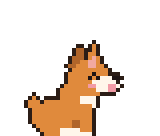
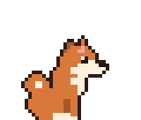
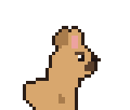
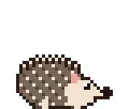
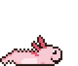
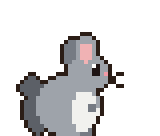

# Snootle

A tiny pixel pet that lives on your Mac. It naps while you're away, cheers you on while you type,
and tells you the moment **Claude Code** needs you — you can even approve Claude's permission
prompts right from the pet.

**[⬇ Download Snootle for Mac](https://github.com/rohith1125/snootle/releases/latest/download/Snootle.dmg)** ·
[Website](https://rohith1125.github.io/snootle/) · [All releases](https://github.com/rohith1125/snootle/releases)

macOS 14 Sonoma or later · Apple Silicon and Intel · free beta, every pet unlocked

## Install
1. Open `Snootle.dmg` and drag **Snootle** into **Applications**.
2. Open Snootle. If macOS says it can't be opened or verified, click **Done**, then go to
   **System Settings → Privacy & Security**, scroll down and click **Open Anyway** (once).
3. For typing reactions, switch Snootle on in **Privacy & Security → Accessibility**.
4. To connect Claude Code: open Snootle Settings (open the app again, or right-click the pet) →
   **Connect Claude Code…**. New Claude Code sessions will drive your pet.

Snootle checks for updates by itself.

## What it does
- Six pets — corgi, shiba inu, French bulldog, hedgehog, axolotl, chinchilla — four coats each, up to three at once
- Wanders, naps, reacts to typing, chases fast cursor flicks, loves being petted, can be dragged around
- **Claude Code:** shows what Claude is doing, celebrates when it's done, looks sad on rate limits,
  lets you **Allow once / Deny** permission prompts from a card above the pet, and jumps to the
  Claude window when you click it
- Pomodoro timer in the menu bar with custom focus/break lengths, levels and a daily recap
- Stretch reminders where your pet stretches with you and suggests a new exercise each time
- Name your pets and feed them (they'll ask when they're hungry)
- Nine animals now, including a cat, a bunny and a duckling
- Every pet has its own voice (barks, meows, quacks…) for when Claude finishes or needs you, when you click, or on a key you pick
- Collectible hats, play ball, daily streaks, and calm pets during focus sessions
- Stand-up and water reminders with their own animations (fully adjustable)
- Welcome-back recap of what each Claude session did, plus a menu-bar count of working/waiting sessions
- The permission card always shows the complete request before you can allow it
- Knows how your Mac feels: sleepy on low battery, panting when it's hot, still in Low Power Mode
- **⌃⌥P** hides all pets (handy for screen sharing)

## Privacy
No telemetry and no accounts. Snootle counts key presses but never sees which keys.
Its only network listener is on your own Mac (`127.0.0.1:47823`) for Claude Code hooks.

## Feedback
Found a bug or have an idea? [Open an issue](https://github.com/rohith1125/snootle/issues).

This repository hosts releases and the website; the source code is private.
